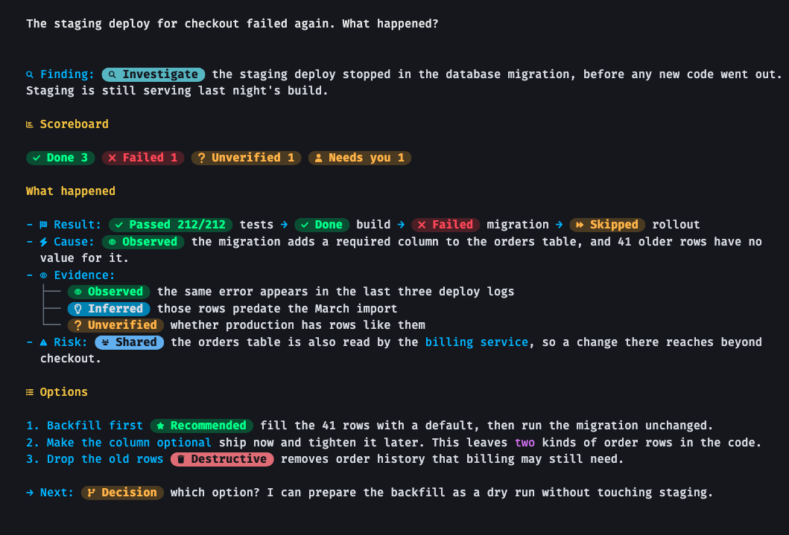
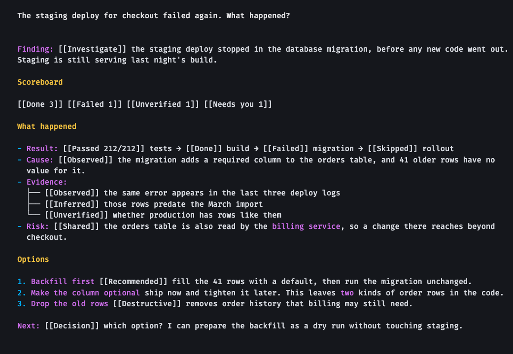
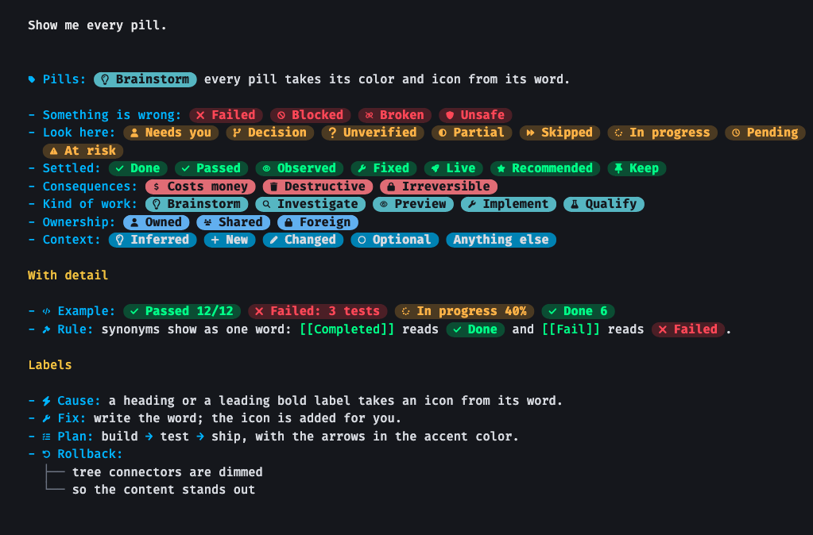

# omp Emphasis

Replies you can scan. This [omp](https://github.com/can1357/oh-my-pi) extension turns `[[Done]]`, `[[Failed]]` and `[[Needs you]]` into colored pills with icons, gives headings and lead labels an icon from their word, and colors bold text, arrows and tree lines. It is a port of John Lindquist's [pi-emphasis](https://github.com/johnlindquist/pi-emphasis), which omp cannot load because it uses Pi 1.5 APIs that omp does not have.



The reply above is an invented example about an imagined deploy. This is the same reply without the extension:



It changes only what is drawn. Stored messages, copied text and HTML exports keep the original Markdown. It calls no model and costs nothing to run.

## Requirements

| You need | Why | Without it |
|---|---|---|
| [omp](https://github.com/can1357/oh-my-pi) 18.14 or newer (checked on 18.22.2) | Earlier versions cannot change how replies are drawn | The extension fails to load |
| The `extensionRenderers.assistantText` setting turned on | omp only lets extensions change how replies are drawn when this setting is on | Pills stay as `[[Done]]` |
| A terminal that can draw [Nerd Font](https://www.nerdfonts.com/) symbols | The icons and the rounded pill ends are Nerd Font symbols | You see empty boxes or question marks. See [Set up your terminal](#set-up-your-terminal) |
| A terminal with 24-bit color | Pills are the theme's tool panel tinted with each tone's color | Pills are drawn in reverse video |
| `git` | `omp install` clones this repository | The install fails |

Checked on macOS only. Setup takes about two minutes if your terminal already has the symbols.

## Install

```sh
omp install git:github.com/mrm007/omp-emphasis
omp config set extensionRenderers.assistantText true
tern plugin install github.com/mrm007/omp-emphasis/tern   # Tern only: draws the pills
```

Then start omp again. The setting is also under Tools, Extensions, Extension Reply Renderers in `/settings`.

- List: `omp plugin list`, `tern plugin list`
- Remove: `omp plugin uninstall omp-emphasis`, `tern plugin remove omp-emphasis`

## Set up your terminal

**1. Check whether your terminal already draws the symbols.** Paste this into your shell:

```sh
printf '\ue0b6\uf00c \uf128 \uf007\ue0b4\n'
```

You should see a half circle, a check mark, a question mark, a person and another half circle. If you do, skip to step 3. Ghostty, kitty and WezTerm include these symbols, so they usually pass with any font.

**2. If you see boxes, install a Nerd Font and select it.** On macOS with Homebrew:

```sh
brew install --cask font-jetbrains-mono-nerd-font
```

Or download any family from [nerdfonts.com](https://www.nerdfonts.com/font-downloads). Then choose it as the terminal's font and run the check again:

| Terminal | Where the font is set |
|---|---|
| iTerm2 | Settings, Profiles, Text, Font |
| macOS Terminal | Settings, Profiles, Text, Font |
| VS Code terminal | the `terminal.integrated.fontFamily` setting, for example `JetBrainsMono Nerd Font` |
| Alacritty | `font.normal.family` in `alacritty.toml` |

To keep your current font, install only the symbols with `brew install --cask font-symbols-only-nerd-font` and add "Symbols Nerd Font" as a fallback font where your terminal supports one.

**3. Check it in omp.** After installing the extension and starting omp again, ask:

> Reply with one line that uses the pills [[Done]], [[Needs you]], [[Failed]] and [[Costs money]].

You should see four rounded pills in green, yellow, soft red and solid red, each with an icon.

**No Nerd Font, or you prefer plain chips?** Start omp with the icons and rounded ends turned off. To make it permanent, put the two `export` lines in your shell profile, such as `~/.zshrc`:

```sh
export PI_EMPHASIS_PILL_ICONS=0
export PI_EMPHASIS_ROUND_CAPS=0
omp
```

## The rules come with it

An agent writes pills only when it is told how. In omp's terminal interface the extension adds a `<reply_style>` block to the end of the system prompt for every prompt, so there is nothing to paste into an `AGENTS.md`. The block tells the agent:

- which words to use for each color, and that every failure, ask and unchecked claim needs its pill
- to open a reply with the kind of work it understood, and to mark consequences and ownership
- to follow each attention pill with the action it calls for, such as the fastest check after `[[Unverified]]`
- to write labels as plain words, because the extension adds the icons

The word lists in that block are read from the same tables that color the pills, so the rules and the drawing cannot drift apart. It adds about 1,500 tokens to the prompt. Print, JSON and RPC runs and subagents do not get the block, since nothing there draws pills.

To keep the drawing and write your own rules, set `PI_EMPHASIS_GUIDANCE=0`.

## Pills

Write `[[Word]]` beside the thing it describes. The word decides the color and the icon.



| Color | Meaning | Words |
|---|---|---|
| Red | Something is wrong | Failed, Blocked, Broken, Unsafe, Rejected, Down |
| Yellow | Look here | Needs you, Decision, Unverified, Partial, Skipped, In progress, Pending, At risk, Review, Todo, Stale, Draft |
| Green | Settled | Done, Passed, Observed, Fixed, Live, Recommended, Keep, Ready, Merged, Safe, Verified, Shipped, Approved, Healthy |
| Solid red | Consequences | Costs money, Destructive, Irreversible |
| Cyan | Kind of work | Brainstorm, Investigate, Preview, Implement, Qualify |
| Solid blue | Ownership | Owned, Shared, Foreign |
| Soft blue | Context | Inferred, New, Changed, Optional, and any other label |

- **Detail.** A known word may be followed by detail: `[[Passed 12/12]]`, `[[Failed: 3 tests]]`, `[[In progress 40%]]`.
- **Synonyms.** Completed, Complete, OK and Finished display as Done. Fail, Failing and Error display as Failed. Pass displays as Passed, Waiting as Pending, and Needs review as Review.
- **Your own icon.** A label that starts with a Nerd Font glyph keeps that glyph.
- **Length.** A label can be up to 32 characters. Longer ones are left as typed.

## Labels and shapes

- **Headings and lead labels.** A `##` heading, or bold text at the start of a line or list item, takes an icon when it is one of: Finding, Result, Status, Evidence, Cause, Effect, Fix, Risk, Limits, Cost, Decision, Options, Plan, Next, Why, How, Rule, Example, Checked, Verdict, Rollback, Undo, Review, Scoreboard, Terminal, Folder, File, Branch, Ideas, Pills, Colors, Icons. A trailing colon is fine.
- **Action lead-ins.** Bold **Check:**, **Do:**, **Next:**, **Unblock:**, **Left:**, **Run:**, **Guard:**, **Undo:** and **See:** take an icon anywhere in a line, so the action that follows a pill is easy to find: `[[Unverified]] the red pills on your screen. **Check:** start omp again.` The colon is required.
- **Bold.** `**anchor term**` keeps its weight and takes the theme's link color.
- **Marks.** `✓` takes the success color, `✗` the error color, and `→` the accent color.
- **Trees.** `├──` and `└──` are dimmed so the content stands out.

Your own messages, inline code, fenced code and escaped asterisks are left alone.

## Settings

Environment variables, with the same names as in pi-emphasis. Set them in the shell before starting omp, or in your shell profile:

- `PI_EMPHASIS_COLOR`: theme color for bold text (default `mdLink`).
- `PI_EMPHASIS_ROUND_CAPS=0`: square chips, for fonts without Nerd Font symbols.
- `PI_EMPHASIS_PILL_ICONS=0`: no icons in pills or on labels.
- `PI_EMPHASIS_GUIDANCE=0`: do not add the reply-style rules to the prompt.

To add a word, an icon or a synonym, edit the tables at the top of [`index.ts`](index.ts). The rules are the `replyGuidance` function in the same file.

## Troubleshooting

| You see | Cause | Fix |
|---|---|---|
| `[[Done]]` as plain text | The extension is not loaded, or `extensionRenderers.assistantText` is off | Run `omp config get extensionRenderers.assistantText` and check that `omp plugin list` shows omp-emphasis, then start omp again |
| `Failed to load extension: pi.registerAssistantTextRenderer is not a function` | The `omp` on your PATH is older than 18.14 | Run `which -a omp` and update or remove the old one |
| Boxes or question marks in or around pills | The terminal has no Nerd Font symbols | [Set up your terminal](#set-up-your-terminal), or turn icons and rounded ends off |
| Icons that overlap the next letter | The font draws its icons two cells wide | Use the "Mono" variant of the Nerd Font, such as JetBrainsMono Nerd Font Mono |
| Pills that are all one color, in reverse video | The theme's colors are not 24-bit, so there is no panel to tint | Set `COLORTERM=truecolor` if your terminal draws 24-bit color |
| Solid red, cyan or blue pills in odd shades | Those three use your terminal's own colors | Change the terminal's color theme |
| Bold that looks no heavier than normal text | The terminal draws normal text at a medium weight, or its font has no real bold | Choose a font with a distinct bold. In Ghostty, `font-style-bold` selects a heavier face |
| The agent writes no pills | The rules reach the agent only in omp's terminal interface, and not when `PI_EMPHASIS_GUIDANCE=0` | Unset the variable. Print, JSON and RPC runs and subagents never get the rules |
| Pills inside code blocks stay as typed | Code is left alone on purpose | Nothing to fix |

## Limits

- A bold span that continues onto a second source line is colored only on its first line.
- Tern's native view draws the Markdown itself, in a proportional font, and cannot show terminal colors. There each pill is a link to `#omp-pill-<tone>` that the Tern plugin in [`tern/`](tern) draws as the terminal draws a pill: bold mono text in the tone's color on a tint of it, and reverse video in the theme's red, cyan and blue for consequences, kind of work and ownership. Every pill's text keeps at least 3:1 contrast with its fill in Tern's dark, light, titanium and porcelain themes. The extension sends links only when it finds the plugin in Tern's plugins folder, which it knows only on macOS (or from `TERN_CONFIG_DIR`); otherwise pills are uncolored code chips. Tree rows become nested list items, because box-drawing connectors only line up in a monospace font. Labels and icons are the same as in the terminal; bold, arrows and marks take Tern's own styling.
- Checked on macOS only, with omp 19.0.1 and Tern 0.9.29.

## Development

```sh
bun install
bun run check                # types and tests
python3 demo/shots.py        # redraw the demo replies in a real omp session, as HTML to screenshot
```

`demo/` holds the two example replies. `sgr-sampler.sh` prints every terminal text style so you can see which ones your terminal draws.

To see a reply in Tern's native view without touching your windows, start a headless Tern and replay a session in it:

```sh
tern serve --control /tmp/check.sock --out /tmp/shots &
tern ctl --control /tmp/check.sock type '"omp --resume /path/to/session.jsonl"'
tern ctl --control /tmp/check.sock key enter
tern ctl --control /tmp/check.sock resize 1100 1900   # taller, to fit the whole reply
tern ctl --control /tmp/check.sock shot reply         # writes /tmp/shots/serve/reply.png
tern ctl --control /tmp/check.sock quit
```

A headless Tern loads no plugins: before `shot`, add the pill sheet with `tern ctl --control /tmp/check.sock css omp-emphasis "$PWD/tern/pills.css"`, and start omp with `TERN_CONFIG_DIR` pointing at a folder whose `plugins/` has the plugin linked (`TERN_CONFIG_DIR=… tern plugin link tern`), so the extension sends link pills.
